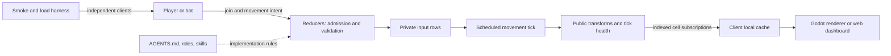

# Moshu's MMO Agent Kit

Build a server-authoritative multiplayer prototype on **SpacetimeDB 2.14.0** with reference modules, client starters, agent instructions, and executable verification tools.

For developers working with a coding agent: start with a small movement world, prove that two independent clients observe each other, then add gameplay under the same authority and verification rules. This is a starting kit; production capacity depends on your game, hardware, subscriptions, and measurements.

[Start here](docs/wiki/Installation.md) | [Documentation](docs/wiki/Home.md) | [Template guide](docs/wiki/Server-and-client-templates.md) | [Contributing](CONTRIBUTING.md) | [Security](SECURITY.md)



## Get a local world running

Install the versions in [stdb.lock](stdb.lock): Python 3.11+, Node 22+, SpacetimeDB 2.14.0, and Rust 1.97.1 with `wasm32-unknown-unknown`. Windows Rust builds also need the Visual Studio C++ build tools. Godot 4.7 is optional for the minimal bot path. See [installation](docs/wiki/Installation.md) for platform details.

From the repository root, run the isolated verification path:

```sh
python tools/quickstart/verify.py
```

It builds from source, installs locked bot dependencies, generates fresh bot bindings, typechecks, starts its own server on a free loopback port, publishes, and runs two-client smoke. It retains logs and `receipt.json` in the printed external work directory and stops its owned server on exit. Add `--loadtest` for a 10-bot, five-second diagnostic. [Installation](docs/wiki/Installation.md) explains options and prerequisites. On Windows use Developer PowerShell with the Visual Studio C++ workload.

For the manual development loop, start a local server in one terminal:

```sh
python tools/kit.py server --isolated
```

In a second terminal:

```sh
python tools/kit.py publish
python tools/kit.py smoke
```

The smoke harness uses the real SDK and subscriptions: two identities join, send movement intent, and each must observe the other's movement. Look for the final `SMOKE PASS`; a successful publish alone does not prove the client path. Installation downloads and first compilation vary, so no fixed setup time is promised. Use a fresh disposable local database, and read [testing](docs/wiki/Testing.md) before changing endpoints or wiping data.

## Choose the right starting point

| Component | Purpose | Evidence and limits |
|---|---|---|
| [rust-single](templates/server/rust-single) | 20 Hz movement, admission, AOI cells, health | Historical Linux build and two-client smoke; Windows runtime used prebuilt Wasm |
| [ts-single](templates/server/ts-single) | TypeScript implementation of the movement world | Historical local cross-client verification |
| [rust-sharded](templates/server/rust-sharded) | Global registry, region databases, outbox handoff | Historical local handoff and spoof-rejection tests; more operational work |
| [rust-shard](templates/server/rust-shard) + [godot-shard](templates/client/godot-shard) | Tile world, NPCs, combat, items, world-document adapter | Historical synthetic Meadowmere fixture checks; separate schema from movement world |
| [godot](templates/client/godot) | Movement client using the vendored community SDK | Historical headless two-client smoke; engine versions recorded in verification log |
| [web-admin](templates/client/web-admin) | Live map and operations UI | Historical build and headless browser exercise |
| [unity](templates/client/unity) | Thin C# starter | Historical headless session check; Unity editor untested |
| [unreal](templates/client/unreal) | Thin C++ starter | Generated bindings and source review; **not compiled** |
| [sidecar](templates/sidecar) | External Node helper and health-guard pattern | Historical local census check; game-specific AI remains your work |

These are summaries of dated records in [VERIFICATION.md](docs/VERIFICATION.md), not results from the current checkout. A fresh Windows movement-path source build and smoke was also exercised during [release preparation](docs/public-readiness/README.md). [Validation policy](docs/wiki/Testing.md) explains what to rerun and how to report fresh evidence. macOS has no recorded runtime proof in that log.

## Make it yours

```sh
python tools/kit.py new my-game --dest ..
python tools/kit.py new my-rpg --server rust-shard --client godot-shard
```

The scaffolder creates `server`, `client`, tooling, rules, skills, and docs; it refuses to overwrite an existing destination. Follow its printed next steps. Template combinations have different schemas: use the [compatibility guide](docs/wiki/Server-and-client-templates.md), then [first project](docs/wiki/First-project.md).

Example agent task:

> Read AGENTS.md and the schema/reducer skills. Add region chat with indexed subscriptions, validate the sender on the server, and report build, binding, and two-client test results.

## How the pieces fit

| Location | Responsibility |
|---|---|
| [AGENTS.md](AGENTS.md), [CLAUDE.md](CLAUDE.md), [agents](agents), [skills](skills) | Agent contract, specialist routing, implementation patterns and official API references |
| [rules](rules), [evals](evals) | Anti-pattern catalog, rule self-tests, documentation checks, and review scenarios |
| [templates](templates), [recipes](recipes) | Runnable starting modules and focused feature examples |
| [tools/kit.py](tools/kit.py), [tools/loadtest](tools/loadtest) | Toolchain diagnosis, scaffolding, publishing, bindings, smoke, and load gates |
| [docs](docs), [kb](kb) | Design guidance, processes, historical evidence, and evidence-tagged knowledge |

The server decides positions and outcomes. Clients subscribe to state and submit intent. `entity_transform` is narrow and indexed by cell; input and admission rows stay private. Scheduled reducers check database identity. Read [architecture](docs/wiki/Architecture.md) for the exact data flow and current cost limits: the movement tick still iterates online entities, and optional housekeeping scans player rows.

For scale work, treat the [scale ladder](docs/scale-ladder.md) as planning guidance. Measure your own workload with the [load harness](tools/loadtest), including row updates, latency, errors, and scheduler lateness. A small local bot run is not a production capacity guarantee.

## License and attribution

Kit-authored material is [Apache-2.0](LICENSE). [NOTICE](NOTICE) records the vendored Apache-2.0 official skills and MIT Godot SDK; preserve their licenses and human/upstream attribution. The SpacetimeDB server is separately licensed under BSL 1.1. Its [2.14.0 license](https://github.com/clockworklabs/SpacetimeDB/blob/v2.14.0/LICENSE.txt) restricts production use to at most one instance and excludes a Database Service under its Additional Use Grant. Review the actual terms and [licensing guide](docs/legal/LICENSING.md) for your topology. No legal certification is implied.

See the [dependency inventory](docs/legal/DEPENDENCIES.md) for resolved package-license evidence and release checks. Vendored SDK copies include local modifications; their version label does not imply unmodified upstream bytes.

This is an independent community project. Do not copy proprietary game assets/data or GPL code into the kit. See [contribution rules](CONTRIBUTING.md) and [release maintenance](docs/wiki/Release-maintenance.md).
