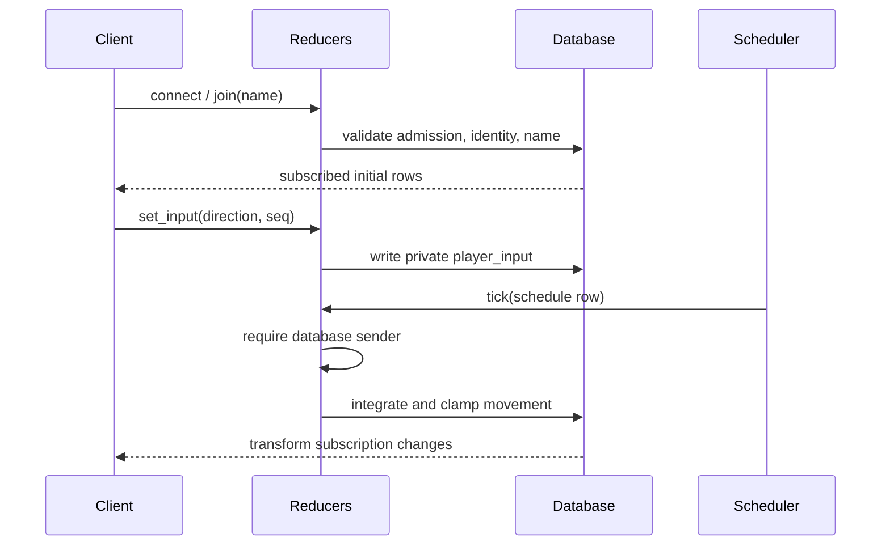

# Architecture

The movement reference is [rust-single/src/lib.rs](../../templates/server/rust-single/src/lib.rs). It defines tables, validates intent, integrates movement, and exposes state for subscriptions. Clients never provide authoritative positions or timestamps.

## Data and trust boundaries

| Table | Visibility | Role |
|---|---|---|
| world_config | Public | Bounds, tick settings, admin identity, admission flag |
| allowlist | Private | Identities admitted when closed |
| player | Public, cold | Name, online state, timestamps, saved position |
| player_input | Private | Latest caller direction and sequence |
| entity_transform | Public, hot | Position, movement flag, acknowledged sequence and AOI cell |
| tick_schedule | Private | Scheduled reducer row |
| tick_health | Public | Lateness, counts and degradation level |

Caller identity comes from `ctx.sender()`. An identity is not a secret; authorization comes from checks. Admin grant/revoke operations take a target identity but authorize the caller separately. Reducers are transactions: an error rolls back writes. Use module timestamps and deterministic randomness, not network/files or wall-clock calls.

Disconnect removes the transform and saves position. Join restores it and resets input sequencing for a returning session. Test reconnect using the same token: fresh identities cannot expose stale-sequence failures. Multiple simultaneous connections sharing an identity need explicit application semantics and tests.

## Tick cost and AOI

The 20 Hz tick clamps elapsed time, normalizes diagonal movement, and enforces bounds. It iterates all online transforms. Periodic housekeeping scans player rows to count online players; optional work is skipped at health level 2 or higher. These scans are not a fixed work budget. Add explicit limits, admission controls, or partitioning when measurements require them. Source defines exact behavior; AGENTS.md states requirements to enforce as you extend it.

Cell-indexed subscriptions reduce delivered rows. Subscribe to your own transform first to discover its cell, then update neighboring-cell subscriptions. Public rows remain queryable outside AOI. Hidden state needs private tables and authorized views/projections, not narrower client queries.

Subscriptions belong to a connection generation. Recreate typed handles after replacement/reconnect; an old handle is not proof that the new connection receives rows. Fence delayed callbacks against their owning generation, release old subscriptions, and test initial state plus changes after reconnect. When a dedicated identity subscription owns the local transform, exclude that identity from cell subscriptions to avoid overlapping ownership. These principles need client-specific tests; they do not imply that every lifecycle fix is already implemented.

## Multiple databases and adapters

The [sharded reference](../../templates/server/rust-sharded/README.md) separates registry/home data from simulation. Outbox calls are not cross-database transactions. Ownership follows lock → offer → accept → delete → activate, with handoff keys, peer authorization, and inactive arrivals. Test retries/failures, not just a successful border crossing.

The [tile shard core](../SHARD_CORE.md) is a separate schema and adapter contract. [Scale guidance](../scale-ladder.md) describes design choices, not proven capacity. Production topology must also comply with the separately licensed server terms.
